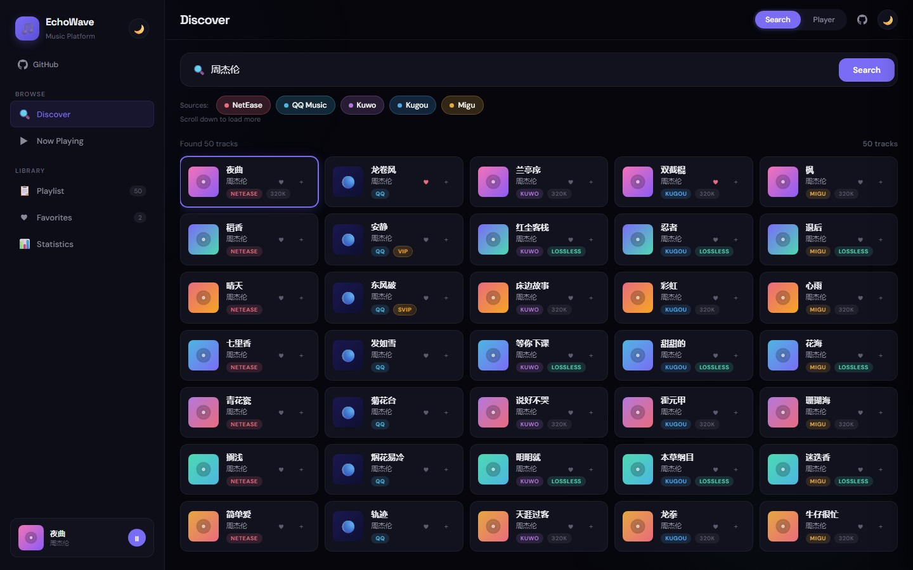
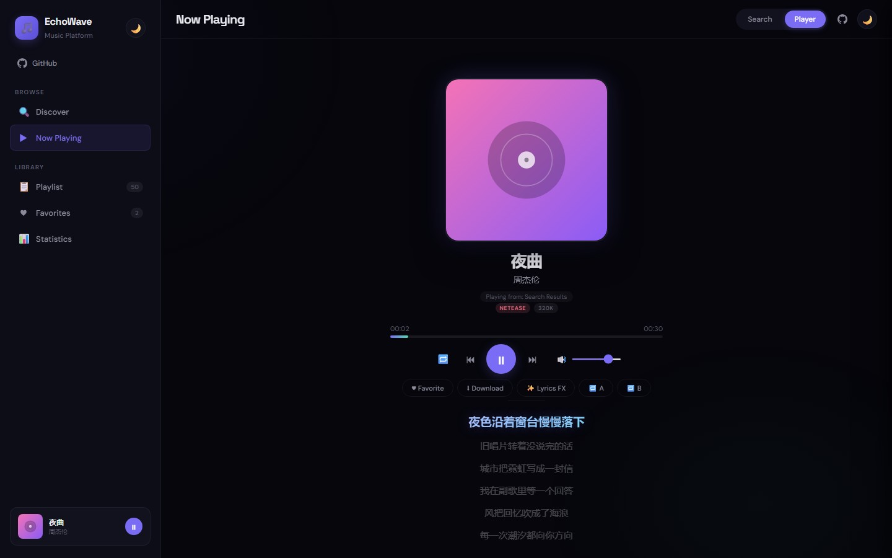

<div align="center">
  <h1>🎵 EchoWave Music</h1>
  <p><em>多音源在线音乐搜索与播放 · 单文件前端 · 本地代理后端</em></p>
  <p>
    <a href="https://huiihao.github.io/EchoWave-Music/"></a>
    
    
    
    <a href="https://github.com/huiihao/EchoWave-Music/actions/workflows/ci.yml"></a>
  </p>
</div>

---

EchoWave 是一个可以直接在浏览器里搜索、播放和整理音乐的开源项目。前端是**零构建的单文件原生 JavaScript**；完整版附带一个基于 Python 标准库的 HTTP 代理，通过 [musicdl](https://github.com/CharlesPikachu/musicdl) 接入 5 个音源。收藏、歌单、搜索历史和听歌统计全部保存在浏览器 `localStorage`，不需要账号或数据库。

<p align="center">
  <a href="docs/preview-discover.jpg"></a>
  <a href="docs/preview-player.jpg"></a>
</p>
<p align="center"><sub>界面预览（演示数据；封面为本地生成的占位图）</sub></p>

## ✨ 功能

| 模块 | 能力 |
|:---|:---|
| 🔍 搜索 | 5 音源聚合、结果交替展示、按页无限滚动、最近 12 条搜索历史 |
| 🎵 播放 | CDN 流媒体、歌词同步高亮、A/B 循环（标记可拖动）、列表/单曲/随机模式 |
| 🏷️ 信息 | LOSSLESS / 320K 音质标签、VIP / SVIP 标签、封面与专辑信息 |
| 📋 管理 | 收藏、自定义歌单、JSON 导入导出（自动去重）、删除与批量管理 |
| 📊 统计 | 播放次数、收听时长、单曲排行，按播放量或时长排序 |
| 🎨 界面 | Light / Dark 主题、桌面到手机的响应式布局、封面懒加载 |
| ⌨️ 快捷键 | `Space` 播放暂停 · `←/→` 快进退 · `↑/↓` 音量 · `N/P` 切歌 · `F` 收藏 · `L` 歌词特效 |
| 🔌 后端 | 代理自动检测、并发请求、搜索结果与直链 TTL 缓存、CORS 白名单 |

## 🚀 快速开始

**环境要求**：Python 3.8+、现代浏览器（Chrome / Edge / Firefox / Safari）、可访问上游音乐 API 的网络。

```bash
git clone https://github.com/huiihao/EchoWave-Music.git
cd EchoWave-Music
python -m pip install -r requirements.txt
python server.py
```

启动后会自动打开 `http://localhost:5000`。常用参数：

```bash
python server.py --port 5001     # 自定义端口
python server.py --no-browser    # 不自动打开浏览器
```

> 只想快速体验？直接打开 [在线 Lite 版](https://huiihao.github.io/EchoWave-Music/) 即可，无需安装。若要在 Lite 版中启用 Kuwo / Kugou / Migu 的完整播放，仍需在本地运行 `server.py`，页面会自动发现代理。

## 📦 两个版本

| 版本 | 入口 | 默认音源 | 运行方式 |
|:---|:---|:---|:---|
| **完整版** | `index.html` + `server.py` | 5 个（默认勾选 NetEase / QQ / Kuwo） | 本地 `python server.py` |
| **Lite 版** | `docs/index.html` | NetEase + QQ（可手动勾选其他音源） | GitHub Pages / 任意静态托管 |

`docs/index.html` 是由 `build_lite.py` 从 `index.html` 生成的，**请只修改根目录的 `index.html`**，再运行构建脚本同步。

## 🎧 音源支持

“直连”指不启动 `server.py`，由浏览器直接请求第三方 API；“代理”指通过本地 `server.py` + musicdl 播放。

| 音源 | 搜索 | 直连播放 | 代理播放 | 说明 |
|:---|:---:|:---:|:---:|:---|
| NetEase | ✅ | ✅ | — | meting 直链 |
| QQ Music | ✅ | ✅ | — | tang 直链 |
| Kuwo | ✅ | ⚠️ | ✅ | 直连依赖第三方 API，网络不通时请用代理 |
| Kugou | ✅ | ❌ 预览 | ✅ | 直连仅提供搜索，播放需代理 |
| Migu | ✅ | ❌ 预览 | ✅ | 直连会回退到 NetEase 数据，播放需代理 |

未启用代理时，界面会给不可直连播放的音源标注 `preview`。

## 🏗️ 架构

```text
浏览器 (index.html)
  ├─ UI / 收藏 / 歌单 / 统计 / 主题 ────── localStorage
  ├─ NetEase / QQ ───────────────────── 直连第三方 API
  └─ Kuwo / Kugou / Migu ── /api/* ── server.py ── musicdl ── CDN
```

- `server.py` 使用 Python 标准库 `ThreadingHTTPServer`，无需额外 Web 框架。
- 搜索结果缓存 5 分钟，单曲直链缓存 10 分钟，减少对上游的重复请求。
- 所有用户数据只存在于当前浏览器的 `localStorage`，不会上传到服务器。

## 📂 项目结构

```text
EchoWave-Music/
├── index.html          ← 前端唯一源文件 (5 音源)
├── server.py           ← 一体化服务器 (静态 + 代理 API + 自动打开浏览器)
├── build_lite.py       ← 从 index.html 生成 docs/index.html
├── docs/
│   ├── index.html      ← GitHub Pages 部署 (Lite 版，生成文件)
│   └── preview-*.jpg   ← README 界面预览图
├── tests/
│   ├── test_server.py  ← 服务器辅助函数、HTTP API 与构建一致性测试
│   └── smoke_ui.py     ← Playwright 端到端冒烟测试 (mock 上游 API)
├── .github/workflows/
│   └── ci.yml          ← 语法检查 + 单元测试 + 构建校验
├── requirements.txt
├── requirements-dev.txt
├── LICENSE
└── README.md
```

## 🛠️ 开发

```bash
# 修改 index.html 后，重新生成 Lite 版
python build_lite.py

# 校验 docs/index.html 是否与源文件同步（CI 使用）
python build_lite.py --check

# 运行单元测试与 HTTP API 测试
python -m unittest discover -s tests -v

# 可选：无头浏览器冒烟测试（覆盖搜索分页、收藏、歌单、播放、AB 循环）
python -m pip install -r requirements-dev.txt
playwright install chromium
python tests/smoke_ui.py
```

CI 会在 push / PR 时执行 Python 语法检查、单元测试和构建一致性校验。

## 🔌 API

| 方法 | 路径 | 关键参数 | 说明 |
|:---|:---|:---|:---|
| `GET` | `/api/status` | — | 返回 `status`、`version`、`available`、`ready` |
| `GET` | `/api/search` | `source`、`keyword`、`limit`、`page` | 返回 `total` 与当前页 `results` |
| `GET` | `/api/url` | `source`、`id` | 返回单曲 `audio_url` |

- `source` 取值：`netease`、`qq`、`kuwo`、`kugou`、`migu`
- `limit` 范围 1–50，默认 10；`page` 范围 1–100，默认 1
- 示例：

```bash
curl "http://localhost:5000/api/search?source=netease&keyword=周杰伦&limit=10&page=1"
```

## ⚙️ 配置

| 环境变量 | 默认值 | 说明 |
|:---|:---|:---|
| `ECHOWAVE_PORT` | `5000` | 监听端口（`--port` 优先） |
| `ECHOWAVE_SEARCH_SIZE` | `30` | 每个音源单次抓取的结果上限（最高 100） |
| `ECHOWAVE_CACHE_TTL` | `300` | 搜索结果缓存秒数 |
| `ECHOWAVE_ALLOWED_ORIGINS` | 空 | 额外允许跨域读取代理的 Origin，逗号分隔 |

默认只允许以下来源访问本地代理：

- `localhost` / `127.0.0.1` / `::1`
- 官方站点 `https://huiihao.github.io`
- 从磁盘直接打开的页面（`Origin: null`）

把 Lite 版部署到其他域名时，需要显式配置：

```bash
ECHOWAVE_ALLOWED_ORIGINS=https://your-site.example python server.py
```

## 🌐 部署

### Lite 版 / GitHub Pages

1. 修改并构建：

   ```bash
   python build_lite.py
   ```

2. 仓库 **Settings → Pages**：
   - Source 选择 **Deploy from a branch**
   - Branch 选择 `master`，目录选择 **`/docs`**
3. 推送到 `master` 后，GitHub Pages 会自动更新。

### 完整版 / 自托管

- 直接运行 `python server.py`。服务器只监听 `127.0.0.1`，默认仅本机可访问。
- 如需从其他域名调用代理，设置 `ECHOWAVE_ALLOWED_ORIGINS`。
- HTTPS 页面调用 `http://localhost` 时，Chrome / Firefox 会将 localhost 视为可信来源；若浏览器仍拦截，改为直接访问 `server.py` 提供的页面。

## ❓ 常见问题

| 现象 | 排查方向 |
|:---|:---|
| 侧栏提示 `Proxy offline` | 未启动 `server.py`，或未安装 musicdl。运行 `pip install -r requirements.txt && python server.py` |
| 端口被占用 | 换端口：`python server.py --port 5001` |
| 某些音源显示 `preview` | 该音源需要本地代理才能播放；启动 `server.py` 后刷新页面 |
| 点击播放提示 `No playable audio` | 该曲目在上游无版权/无直链，或当前音源需要代理 |
| 自定义域名报 CORS 错误 | 设置 `ECHOWAVE_ALLOWED_ORIGINS=https://your-site.example` |
| 封面不显示 | 上游封面 URL 失效；界面会自动隐藏，不影响播放 |
| 搜索无结果 | 检查是否勾选了音源；第三方 API 可能临时限流或变更 |

## 📝 说明与限制

- 本项目依赖第三方音乐 API 与 musicdl，接口可能随时变更、限流或失效，无法保证长期可用。
- 音质与 VIP 标签仅反映上游返回的信息；本项目不会绕过付费或版权限制。
- 收藏、歌单和统计保存在 `localStorage`，不同浏览器/设备之间不会同步，清除站点数据会丢失。
- 仅用于学习与个人使用，请遵守各音乐平台的版权与使用条款。

## 🤝 贡献

欢迎提交 Issue 或 PR。提交前建议运行：

```bash
python build_lite.py --check
python -m unittest discover -s tests -v
```

前端请只修改 `index.html`，并同步生成 `docs/index.html`；不要直接编辑生成文件。

## 🙏 致谢

本项目基于以下优秀的开源项目构建：

<table>
<tr>
<td align="center"><a href="https://github.com/CharlesPikachu/musicsquare"></a></td>
<td align="center"><a href="https://github.com/CharlesPikachu/musicdl"></a></td>
</tr>
<tr>
<td align="center"><b>🎵 MusicSquare</b><br/>提供浏览器端音乐搜索<br/>与播放的初始设计</td>
<td align="center"><b>🎶 musicdl</b><br/>Python 多音源音乐下载库<br/>为代理后端提供核心引擎</td>
</tr>
</table>

感谢 [**@CharlesPikachu**](https://github.com/CharlesPikachu) 的开源贡献 💛

---

## 📄 License

[MIT](LICENSE) — 仅供学习与个人使用。请尊重各音乐平台的版权与使用条款。
